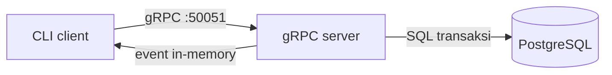

# CinemaRPC

Sistem reservasi tiket bioskop dengan gRPC, Protocol Buffers, PostgreSQL, dan Docker Compose. Database mengunci baris kursi dalam transaksi dan memiliki partial unique index agar satu kursi tidak mempunyai lebih dari satu booking aktif. Request ID dijaga di dalam PostgreSQL, termasuk request duplikat yang datang bersamaan.

## Arsitektur



## Persiapan dan menjalankan

Prasyarat: Docker Engine dan Docker Compose. Salin `.env.example` menjadi `.env`, kemudian atur `POSTGRES_PASSWORD`. Nilai bawaan Compose hanya untuk demonstrasi lokal. Jalankan:

```sh
docker compose up --build -d
docker compose ps
```

Stub Proto dibuat saat image dibangun. Untuk generate di mesin lokal, pasang `requirements.txt`, lalu `python scripts/generate_proto.py`. Data awal SHOW-001 berisi 12 kursi A1-A6 dan B1-B6. Database menggunakan named volume `postgres_data`; SQL seed hanya berjalan saat volume dibuat pertama kali.

## CLI

Semua perintah di bawah berjalan sebagai container terpisah dan menghubungi server melalui nama service `server`:

```sh
docker compose run --rm client list
docker compose run --rm client book SHOW-001 A1 "Nama Pemesan" --request-id pesanan-001
docker compose run --rm client get BOOKING_UUID
docker compose run --rm client cancel BOOKING_UUID --request-id batal-001
docker compose run --rm client watch
docker compose run --rm client race-test
docker compose run --rm client benchmark
```

`book` memakai ID baru jika `--request-id` tidak diisi. Ketika retry manual, gunakan ID dan payload yang sama. ID yang sama dengan payload berbeda ditolak. Timeout dapat diatur lewat `RPC_TIMEOUT`, jumlah percobaan ulang lewat `RETRY_COUNT`. Client mengulang hanya `UNAVAILABLE` dan `DEADLINE_EXCEEDED`, dengan exponential backoff.

`race-test` mengirim dua booking bersamaan untuk A1: satu berhasil dan satu menerima `ALREADY_EXISTS`. Kursi A1 tetap booked setelah demo sampai pembatalan dilakukan.

## Streaming dan batasan

`StreamStatusKursi` mengirim snapshot kursi saat mulai berlangganan, lalu event setelah booking/cancel commit. Subscriber menggunakan queue in-memory yang dibersihkan saat koneksi terputus. Event hanya berjalan di instance server yang sama; belum ada pub/sub lintas replica. Untuk akses host, port 50051 dipetakan ke `localhost:50051`.

## Test dan benchmark

Jalankan `python -m pytest -q`. Test repository membutuhkan `TEST_DATABASE_URL` yang menunjuk ke PostgreSQL khusus test; test dilewati jika variabel itu belum diatur agar database pengembangan tidak terhapus atau termodifikasi tanpa sengaja.

Benchmark menjalankan 100 operasi baca DaftarKursi untuk concurrency 1, 5, dan 20. Hasil aktual tersedia di `results/benchmark.csv`, grafik throughput di `results/benchmark.png`. Satu pengukuran lokal Docker menghasilkan:

| Client | Sukses/error | Throughput req/detik | Latensi rata-rata ms | p95 ms |
|---:|---:|---:|---:|---:|
| 1 | 100/0 | 100.549 | 9.890 | 11.247 |
| 5 | 100/0 | 311.212 | 15.846 | 20.200 |
| 20 | 100/0 | 257.789 | 72.959 | 96.532 |

Angka benchmark bergantung mesin dan kondisi saat pengujian; jalankan ulang command untuk memperoleh CSV/grafik baru. Compose membuktikan komunikasi antarkontainer di satu mesin, bukan di dua mesin fisik.
