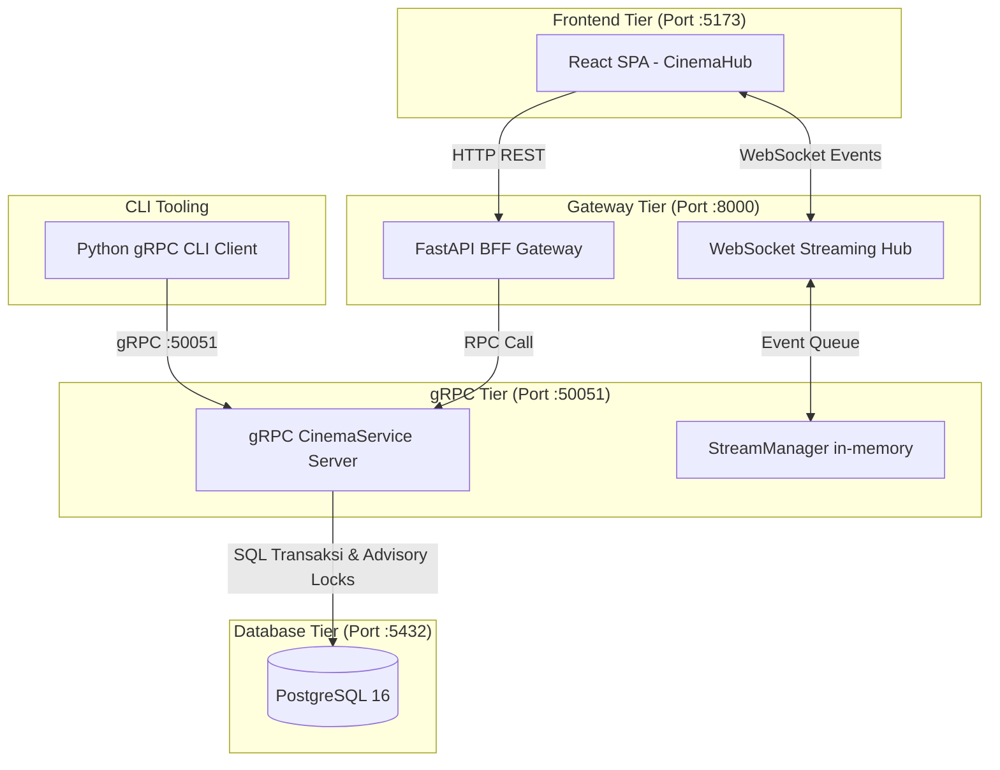

# CinemaHub (CinemaRPC)

Sistem reservasi tiket bioskop terdistribusi berbasis **gRPC, Protocol Buffers, FastAPI Web Gateway, WebSocket, PostgreSQL, dan React (Vite)** yang dijalankan dengan **Docker Compose**.

Sistem ini dirancang untuk mendemonstrasikan penyelesaian tantangan konkurensi (seperti *race condition*, *double-booking*, dan keandalan transaksi) dengan mengunci baris kursi menggunakan *Pessimistic Row-Level Locking* (`SELECT FOR UPDATE`), *PostgreSQL Advisory Lock*, dan *Partial Unique Index*. Perubahan status kursi disiarkan secara *realtime* ke seluruh browser pengunjung melalui WebSocket tanpa perlu me-refresh halaman.

---

## 🏛️ Arsitektur Sistem



---

## 📁 Struktur Proyek

```text
mini-proyek-rpc-bioskop/
├── backend/
│   ├── app/
│   │   ├── generated/         # Stub hasil kompilasi Protocol Buffers
│   │   ├── api.py             # FastAPI REST & WebSocket Gateway
│   │   ├── server.py          # gRPC Server & Servicer
│   │   ├── repository.py      # Operasi database PostgreSQL & locking
│   │   ├── database.py        # Koneksi database psycopg
│   │   ├── stream_manager.py  # Pub/sub antrean in-memory thread-safe
│   │   ├── client.py          # CLI client gRPC bawaan & benchmark
│   │   └── config.py          # Konfigurasi environment
│   ├── proto/
│   │   └── cinema.proto       # Definisi schema Protocol Buffers
│   ├── scripts/
│   │   └── generate_proto.py  # Script kompilasi .proto
│   ├── tests/
│   │   └── test_repository.py # Unit test database repository
│   ├── results/
│   │   └── benchmark.csv      # Hasil pengukuran performa & throughput
│   ├── requirements.txt       # Dependensi Python backend
│   └── Dockerfile             # Multi-stage image server gRPC + FastAPI
├── frontend/
│   ├── src/
│   │   ├── components/
│   │   │   ├── Navbar.jsx      # Header navigasi & status gRPC live
│   │   │   ├── LandingPage.jsx # Hero showcase, alur sistem, & edukasi simulasi
│   │   │   ├── SeatBooking.jsx # Denah kursi bioskop, form tiket, & admin panel
│   │   │   └── Footer.jsx      # Footer minimalis CinemaHub
│   │   ├── data/
│   │   │   └── movies.js       # Metadata film aktif (Siksa Kubur - SHOW-001)
│   │   ├── App.jsx             # Router view SPA
│   │   ├── index.css           # Styling bertema Netflix (DESIGN.md)
│   │   └── main.jsx
│   ├── index.html
│   ├── vite.config.js          # Proxy Vite ke API port :8000
│   └── package.json            # React, Lucide Icons, Vite
├── db/
│   └── init.sql                # Schema DDL PostgreSQL & data awal SHOW-001
├── compose.yaml                # Konfigurasi orkestrasi container Docker
├── DESIGN.md                   # Acuan style guide & design system
├── PRD_CinemaRPC.md            # Product Requirements Document
└── README.md
```

---

## 🚀 Persiapan dan Menjalankan

### Prasyarat
- [Docker](https://www.docker.com/) dan Docker Compose
- [Node.js](https://nodejs.org/) (v18+) untuk menjalankan frontend development

### 1. Salin Konfigurasi Environment
```bash
cp .env.example .env
```
*(Di Windows PowerShell: `Copy-Item .env.example .env`)*

### 2. Jalankan Backend & Database (Docker Compose)
Di root folder proyek, jalankan:
```bash
docker compose up --build -d
```
Pastikan seluruh container dalam kondisi berjalan:
```bash
docker compose ps
```
- PostgreSQL berjalan di port internal `5432`
- gRPC Server berjalan di port `50051`
- FastAPI REST & WebSocket Gateway berjalan di port `8000`

### 3. Jalankan Frontend (React + Vite)
Buka terminal baru, masuk ke direktori `frontend`:
```bash
cd frontend
npm install
npm run dev
```
Buka browser di **`http://localhost:5173`**.

---

## 🌟 Fitur Utama

1. **Landing Page Edukatif:**
   - Menampilkan film utama aktif: ***Siksa Kubur*** (Jadwal `SHOW-001`, Studio 1 Ultra IMAX).
   - Penjelasan visual 5 langkah alur transaksi sistem terdistribusi (Client &rarr; Gateway &rarr; RPC &rarr; Database &rarr; WebSocket Broadcast).
   - Detail teknis mengenai penanganan *concurrency*, *idempotensi*, dan *low-latency RPC*.
2. **Denah Kursi Bioskop Realtime:**
   - 12 kursi studio (Baris A1–A6 dan B1–B6) dengan kontur ergonomis.
   - Status kursi:
     - 🔘 **Tersedia (Available)**: Siap dipesan.
     - 🟡 **Pilihan Anda (Selected)**: Ditandai dengan warna amber cerah.
     - 🔴 **Terisi (Booked)**: Ditandai merah dan terkunci otomatis.
3. **Admin Panel & Transparansi Log Database:**
   - Mengambil data aktual langsung dari tabel database PostgreSQL (`/api/shows/SHOW-001/bookings`).
   - Admin dapat melihat atas nama siapa kursi dipesan, waktu transaksi, dan UUID booking.
   - Tombol **"Hapus / Kosongkan"** pada panel admin memungkinkan pembatalan pesanan dan langsung mengubah kursi menjadi `AVAILABLE` kembali secara seketika di semua layar pengunjung.
4. **Pencegahan Double-Booking (Concurrency Control):**
   - Menggunakan `SELECT ... FOR UPDATE` dan `pg_advisory_xact_lock(hashtextextended(request_id, 0))`.
   - Partial Unique Index `one_active_booking_per_seat` menjamin satu kursi tidak dapat memiliki lebih dari satu pemesanan aktif.
5. **Idempotensi Transaksi:**
   - Setiap request diverifikasi dengan `request_id` unik dan hash payload untuk melindungi transaksi dari duplikasi akibat retry jaringan.

---

## 💻 Pengujian Melalui CLI (gRPC Client)

Perintah CLI dijalankan melalui service container `client`:

```bash
# Menampilkan status seluruh kursi
docker compose run --rm client list

# Memesan kursi (misal kursi A1)
docker compose run --rm client book SHOW-001 A1 "Nama Anda" --request-id req-001

# Melihat detail booking berdasarkan UUID
docker compose run --rm client get <BOOKING_UUID>

# Membatalkan booking
docker compose run --rm client cancel <BOOKING_UUID> --request-id batal-001

# Mendengarkan streaming event kursi secara realtime
docker compose run --rm client watch

# Menjalankan simulasi race-test (2 request pemesanan kursi yang sama secara bersamaan)
docker compose run --rm client race-test

# Menjalankan benchmark throughput & latensi (concurrency 1, 5, 20)
docker compose run --rm client benchmark
```

---

## 📊 Hasil Pengujian Benchmark

Benchmark menjalankan 100 operasi baca `DaftarKursi` pada concurrency 1, 5, dan 20:

| Concurrency | Sukses / Error | Throughput (req/detik) | Rata-rata Latensi (ms) | p95 Latensi (ms) |
|---:|:---:|---:|---:|---:|
| 1 | 100 / 0 | 100.549 | 9.890 | 11.247 |
| 5 | 100 / 0 | 311.212 | 15.846 | 20.200 |
| 20 | 100 / 0 | 257.789 | 72.959 | 96.532 |

Hasil pengukuran tersimpan di `backend/results/benchmark.csv`.

---

## 🛑 Menghentikan Proyek

Untuk menghentikan container backend dan database:
```bash
docker compose down
```
Jika ingin menghapus volume data database agar bersih dari awal:
```bash
docker compose down -v
```
